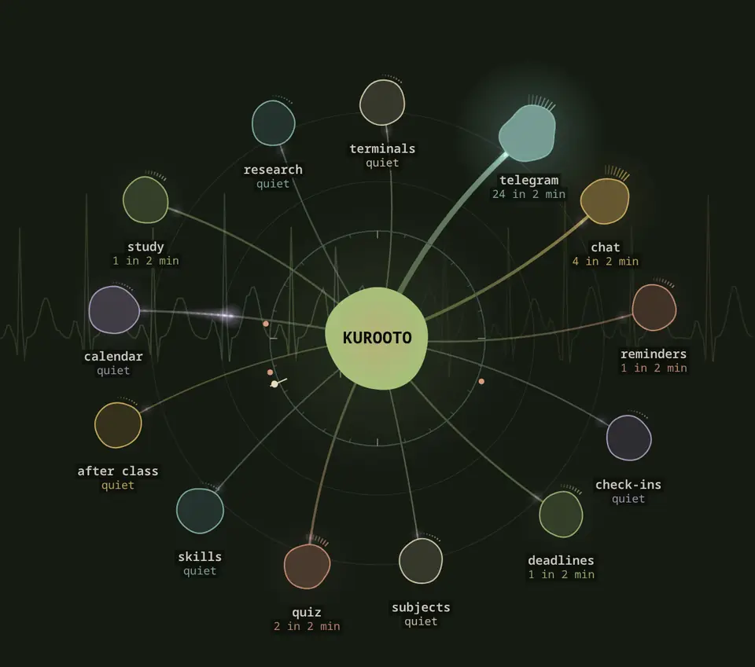
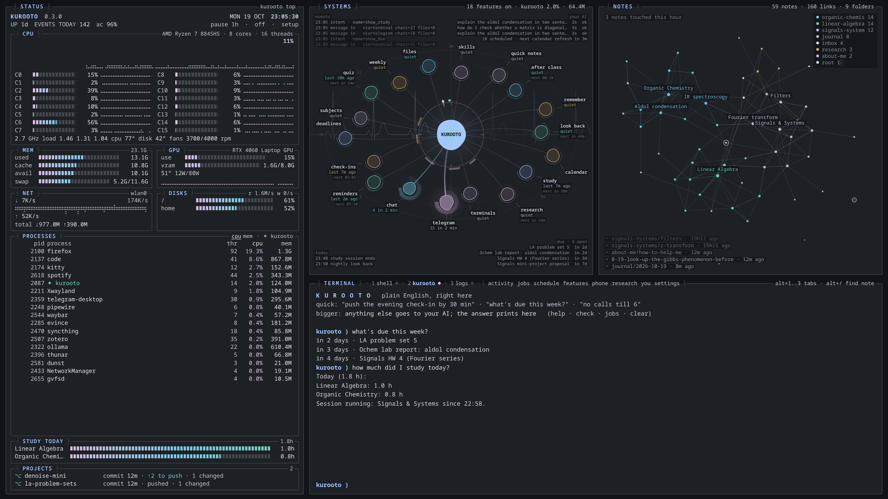
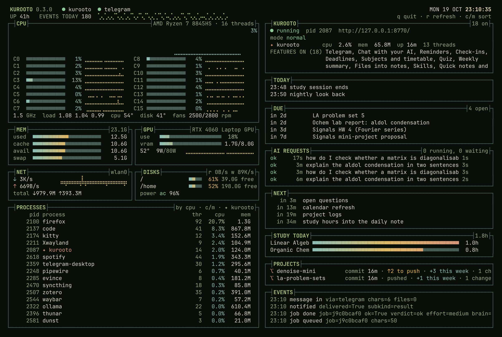
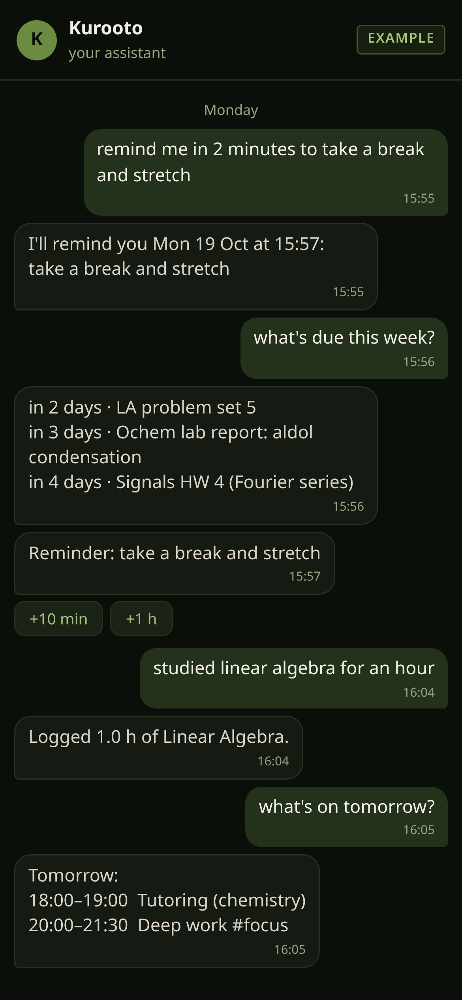
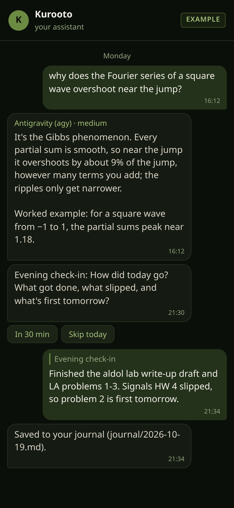
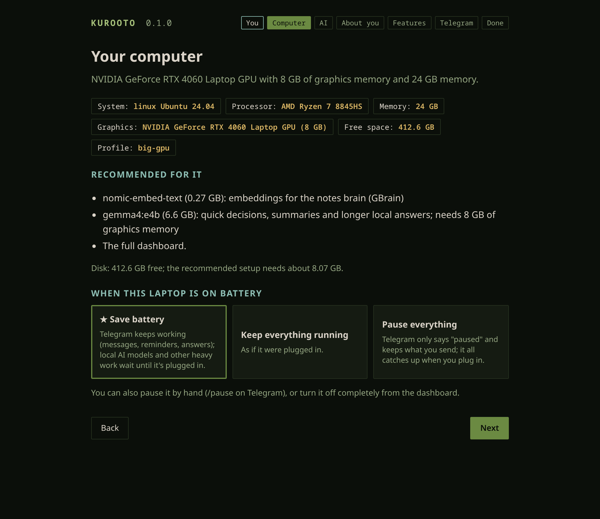
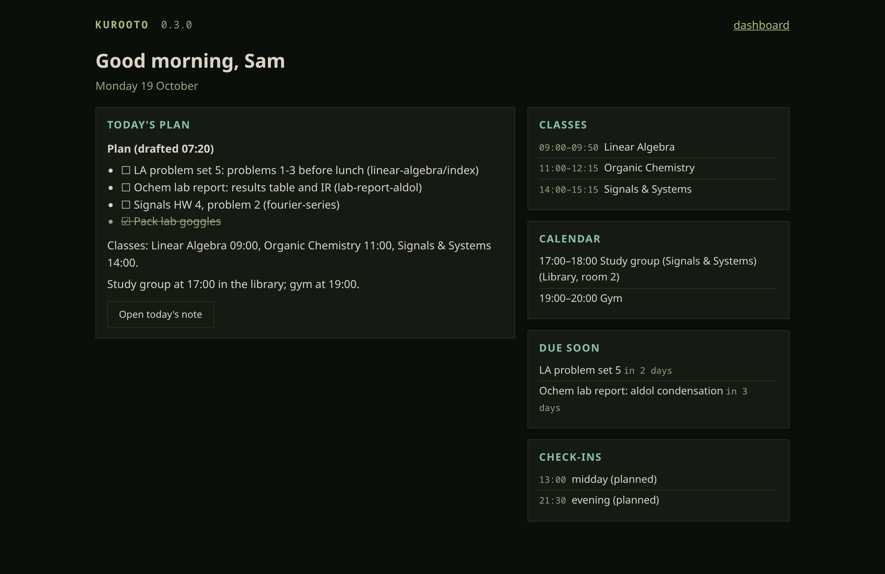

# Kurooto

A personal assistant that runs on your own computer. You talk to it on Telegram, and it can ring your phone. It
reminds you of things, keeps track of deadlines and your calendar, asks how your day went, searches your notes, and
wakes you up in the morning. You choose the AI behind it, and every feature is off until you turn it on.

## Showcase

<p align="center">
  
</p>


<table>
  <tr>
    <td width="50%"></td>
    <td width="50%"></td>
  </tr>
</table>

<p align="center">
  
  &nbsp;
  
</p>

<table>
  <tr>
    <td width="50%"><picture><source media="(prefers-color-scheme: light)" srcset="docs/media/setup-computer-light.webp"></picture></td>
    <td width="50%"><picture><source media="(prefers-color-scheme: light)" srcset="docs/media/morning-light.webp"></picture></td>
  </tr>
</table>

More: [setup: welcome](docs/media/setup-welcome.webp) · [setup: AI](docs/media/setup-ai.webp) ·
[setup: about you](docs/media/setup-about-you.webp) · [setup: features](docs/media/setup-features.webp) ·
[setup on a phone](docs/media/setup-phone.webp) · [the dashboard's terminal](docs/media/dashboard-terminal.webp) ·
[features tab](docs/media/dashboard-features.webp) · [research sources](docs/media/dashboard-research.webp) ·
[phone: call](docs/media/phone-call.webp) · [phone: inbox](docs/media/phone-inbox.webp) ·
[phone: pairing](docs/media/phone-pair.webp) · [the Systems view as video](docs/media/systems-loop.mp4). All of it is a demo with made-up data: Sam, a student taking
Linear Algebra, Organic Chemistry and Signals & Systems.

## Install

**Windows** (PowerShell):
```powershell
irm https://avtarfr.github.io/kurooto/install.ps1 | iex
```
**macOS / Linux** (Terminal):
```sh
curl -LsSf https://avtarfr.github.io/kurooto/install.sh | sh
```

No admin password needed. It installs Kurooto for your user, checks the release's signature, starts it at sign-in and
opens the setup page in your browser. A wizard then reads your computer (graphics card, memory, free space),
recommends settings for it (★), installs whatever the features you pick need, and connects your Telegram bot.

## Your first 15 minutes
1. Paste the line above; the setup page opens.
2. Pick an AI: **Antigravity (agy) ★**, Google's agent program, is free with a Google account: Install, sign in,
   Test. (A Gemini API key works too; calls and voice notes use one.)
3. Pick features: **★ Starter** is a good start.
4. Make your Telegram bot with @BotFather (the wizard walks you through it) and tap Start.
5. Send `/help` to your bot. Try "remind me in 2 minutes to stretch".

## What it can do
| | |
|---|---|
| **Talk** | Telegram or the phone app's own chat (Telegram is optional), plain English or commands; voice messages too; it asks you questions and waits for your OK before anything outward; a persona card you write sets how it talks |
| **Remember** | reminders, check-ins into a journal, deadlines (also from Google Classroom and your calendar), recurring quizzes, how you like to be helped; an encrypted memory you can search and forget (`/memory`), and the threads you're in the middle of (`/threads`) |
| **Phone** | call it like a phone call, and it calls you (reminders, check-in debriefs, deadline nudges, quizzes, a wake-up alarm that rings on silent), even with your computer off; Android app from Android 6, iPhone as a Home Screen app |
| **Notes** | search your notes by meaning, skills like `/journal` and `/study-log`, revision packs as PDF, quick notes, files and handwritten pages into notes, sync to your private GitHub repository; books and class materials read into a concept graph of your notes |
| **Study** | subjects, timetable and term dates, a spaced-repetition quiz with an exam mode, an exam-season card, after-class notes, a study-time tracker, a study mode for the dashboard |
| **Google** | Classroom materials into your notes, a mail digest that reads only what you choose, reply drafts you send with a tap, its own calendar for planned time |
| **Research** | a digest of new papers in your fields (arXiv, bioRxiv, medRxiv, PubMed, any journal's feed), project notes from your code, experiment run logs, a message when a long job ends; minutes and action items for any recurring meeting |
| **Your setup** | daily backups to a folder you pick; your setup encrypted in your private repository, so a new computer is ready in a minute |
| **See it all** | a local dashboard (a calm new look, or the classic one a click away; terminals if you like), a status board in any terminal, and a look back each night that suggests small improvements |

**AI, your choice:** Antigravity (agy) ★ (recommended) or Claude Code (both get the same reach: your notes, your
tools, harmless commands, nothing else), a Gemini API key, local models through Ollama on computers that can run
them, or any OpenAI-compatible service.

**Updates:** automatic at night, signed, and rolled back if a new version misbehaves.

**Privacy:** it runs on your computer; nothing is ever sent to Kurooto's author. What each feature sends where is in
[docs/PRIVACY.md](docs/PRIVACY.md).

## Docs
- [docs/MANUAL.md](docs/MANUAL.md): everything, from install to uninstall, every feature, troubleshooting.
- [docs/SETTINGS_GUIDE.md](docs/SETTINGS_GUIDE.md): every setting with its default and what it does, and what an AI is allowed to do.
- [docs/PRIVACY.md](docs/PRIVACY.md): what leaves your computer, per feature.
- [AGENTS.md](AGENTS.md): for your own AI agent, if you ask one to help you set it up or fix it.
- [docs/REQUESTED.md](docs/REQUESTED.md): what people asked for, open and done.
- [docs/ROADMAP.md](docs/ROADMAP.md): ideas that aren't built yet.
- [CHANGELOG.md](CHANGELOG.md) · [docs/RELEASING.md](docs/RELEASING.md) (for the maintainer)

## License
Apache-2.0, © Sumangalam Avtar Sharma. See [LICENSE](LICENSE) and [NOTICE](NOTICE).
